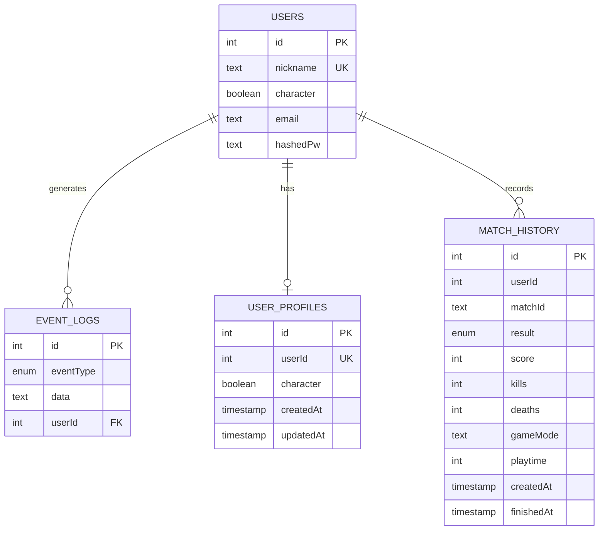

_This project has been created as part of the 42 curriculum by alice, bob, freddy, jeff, mandy._
<!--
# ft_transcendence - A School 3D game

## Current build / dev instruction

In order to run the frontend in dev mode (local, no container):

- install `nodejs` (at best >=v22) on you system
- `cd frontend/`
- in a fresh clone run `npm i`
- `npm run dev`

For multiplayer we need the socket.io-server from `backend/src/server.js`.
To run this this in dev mode (local, no container):

- install `nodejs` (at best >=v22) on you system
- `cd backend/`
- in a fresh clone run `npm i`
- `npm run dev`

To run both backend & frontend from the docker-compose file in repo root:

- `docker compose up --build` ( the `--build` is only necessary the first time)
- optionally add `-d` to run the whole thing in background
- Then open `localhost:1111` in a browser

I created most additional files in the `frontend`-dir via `npm create
vite@latest` with *Typescript* and *React* selected in the dialog. I left the
`frontend/README.MD` has also been generated with the template. Maybe there's
information in there we might need later on....

Added `.editorconfig, .prettierrc, ...` files in order to make code formatting
consistent across all our editors.

---
-->
# ft_transcendence - A School 3D game

## Description

**ft_transcendence** is a browser-based multiplayer 3D game set in a virtual
42 campus. Players can explore the environment, interact with NPCs and objects,
complete quests, communicate with other players, and challenge them to
mini-games.

The project combines a React and Three.js frontend with a TypeScript backend.
Real-time communication is provided by Socket.IO, while authentication,
profiles, event logs, and match history are handled by backend services backed
by PostgreSQL.

Microservices are a central architectural part of this project. Instead of
using one monolithic backend, the application separates backend responsibilities
into focused services:

- **`auth-service`** handles login, logout, JWT session cookies, and session
  validation.
- **`user-service`** handles user profiles, character selection, and user data.
- **`eventlog-service`** stores authenticated events, match results, and
  history data.
- **`conn-service`** manages Socket.IO connections, player presence, movement,
  chat, spectator mode, and real-time mini-game messages.
- **PostgreSQL** stores persistent data used by the backend services.
- **Nginx** provides the public HTTPS entry point and routes API and WebSocket
  traffic to the correct internal service.

This separation gives each service a clear responsibility and makes the
backend easier to develop, test, maintain, and extend.

Key features include:

- a navigable 3D campus with animated player characters;
- real-time multiplayer movement, presence, spectator mode, and chat;
- quests, NPCs, and interactive campus objects;
- Rock-Paper-Scissors and Tic-Tac-Toe mini-games;
- login, logout, profiles, friends, event logs, and match history.

## Instructions

### Prerequisites

Choose either the Docker workflow or the local development workflow.

For Docker:

- Docker Engine or Docker Desktop with Docker Compose;
- a recent Docker Compose version that supports the `include` directive used
  by the Compose files;
- at least 4 GB of available memory for the images and services;
- a modern browser with WebGL support.

The Docker workflow builds the frontend, four backend services, PostgreSQL,
pgAdmin, and the Nginx reverse proxy. Make sure the following host ports are
available before starting:

| Port | Service |
| ---: | --- |
| `1111` | HTTPS application entry point |
| `80` | pgAdmin |
| `5432` | PostgreSQL |

On Windows, Docker Desktop is recommended. The certificate-generation script
is a Bash script and requires Git Bash, WSL, or another Bash environment with
OpenSSL installed. Docker commands themselves can be run from PowerShell.

For local development:

- Node.js 22 or newer;
- npm;
- GNU Make for the optional Makefile shortcuts;
- Docker Compose for the PostgreSQL development container;
- a modern browser with WebGL support.

### Configuration

The repository uses `dev.env` for local service configuration. It contains the
service ports, PostgreSQL connection values, and the JWT signing secret:

```env
AUTH_SERVICE_PORT=3001
EVENTLOG_SERVICE_PORT=3002
USER_SERVICE_PORT=3003
JWT_SECRET=your_jwt_secret_key
DB_HOST=postgres
DB_PORT=5432
DB_USER=postgres
DB_PASSWD=postgres
DB_NAME=postgres
```

These values are intended for local development. Replace the JWT secret and
database credentials before using the project in any non-development
environment.

### Docker execution

1. Clone the repository and open a terminal at its root.
2. Check that Docker is available:

   ```bash
   docker --version
   docker compose version
   ```

3. Generate local TLS certificates if they are not already present:

   ```bash
   make certs
   ```

   The command creates certificates for `localhost` and copies the Nginx
   certificate files into the reverse-proxy configuration. On Windows, run
   this command from Git Bash or WSL. If the certificates already exist, this
   step does not regenerate them.

4. Build and start the complete stack:

   ```bash
   docker compose up --build
   ```

5. Open `https://localhost:1111` in a browser. The local certificate is
   self-signed, so the browser may display a certificate warning.
6. Stop the stack when finished:

   ```bash
   docker compose down
   ```

To run the stack in the background, use:

```bash
docker compose up --build -d
```

Check the service status after startup:

```bash
docker compose ps
```

All application containers should be running. PostgreSQL should report a
healthy status before the database-dependent services are used. To follow all
service output, run:

```bash
docker compose logs -f
```

The main application is available at `https://localhost:1111`. The development
pgAdmin instance is available at `http://localhost`. PostgreSQL is exposed on
`localhost:5432` for local administration tools; application code inside the
Docker network connects to the hostname `postgres`.

To remove containers and networks while keeping the PostgreSQL data volume:

```bash
docker compose down
```

To deliberately remove the local PostgreSQL data and recreate the database:

```bash
docker compose down -v
docker compose up --build
```

The `-v` option is destructive for local database data. Do not use it when
existing development data should be preserved.

#### Docker troubleshooting

If a service does not start, inspect its logs:

```bash
docker compose logs auth-service
docker compose logs user-service
docker compose logs eventlog-service
docker compose logs conn-service
docker compose logs postgres
docker compose logs nginx
```

Common causes are unavailable host ports, missing TLS certificate files,
Docker not having enough resources, or PostgreSQL still starting. If
PostgreSQL is still initializing, wait for its health check and inspect the
database logs before restarting the application services. If the certificate
step fails, verify that OpenSSL is installed and that `make certs` is being
run from a Bash-compatible terminal. If Compose rejects `include`, update
Docker Compose to a recent version.

### Local development execution

1. Install the workspace dependencies from the repository root:

```bash
npm install
```

2. Start the PostgreSQL development container and backend microservices:

   ```bash
   make backend-dev
   ```

   Alternatively, run the backend commands described in the development
   instructions above.

3. In a second terminal, start the frontend:

   ```bash
   make frontend-dev
   ```

   Alternatively, run `npm run dev:frontend` from the repository root.

4. Open the local URL printed by Vite.


### Service routing

In the complete Docker setup, Nginx exposes one public HTTPS endpoint while
the individual services communicate inside the Docker network:

| Route | Destination | Purpose |
| --- | --- | --- |
| `/` | `frontend` | React/Vite application |
| `/api/login`, `/api/logout`, `/api/user`, `/api/validateSession` | `auth-service` | Authentication and session APIs |
| `/api/eventlog` | `eventlog-service` | Event and match-history APIs |
| User profile API routes | `user-service` | Profile and user-data operations |
| `/socket.io` | `conn-service` | Real-time multiplayer communication |

The service containers are started with Docker Compose. In local development,
the same services can be run independently while PostgreSQL is provided by the
database Compose configuration.


## Team Information
Product Owner, Tech Lead, Project Manager

| Team member | Role(s) | Responsibilities                                                                                   |
| --- | --- |----------------------------------------------------------------------------------------------------|
| Anatolij Semykin (`alice`) |  Developer | Product direction, 3D environment, character assets, visual interactions, and frontend integration |
| Daniel Helmert (`bob`) |  Developer | Architecture, real-time multiplayer, mini-games, frontend refactoring                              |
| Moritz Maurer (`freddy`) |  Developer | Architecture, Planning, coordination, build reliability, and integration                           |
| George Lukas Wagner (`jeff`) | Developer | Feature development, testing, and integration support                                              |
| Maryam Pazouki (`mandy`) | Developer | User-facing flows, Database, Documentation                                                         |

The team shared responsibility for code review, debugging, testing, and
integration. Role descriptions identify the main areas of responsibility and
do not exclude contributions to other parts of the project.

## Project Management

Work was divided into frontend gameplay and UI, real-time multiplayer,
backend services, persistence, deployment, and integration. The team used one
`development` branch for ongoing project work and feature integration. The
`main` branch was reserved for production-ready and final project code.
Changes were reviewed through pull requests before being merged into the
appropriate branch.

GitHub Issues and pull requests were used to track work and discuss bugs and
features. The team also used a **GitHub Project board** to organize issues,
prioritize tasks, and monitor their progress. GitHub was also used for code
review and integration. The team used regular meetings and a shared team chat
in Slack for day-to-day communication. The shared `common` package and the
repository Makefile were used to keep frontend/backend contracts and
development commands consistent.

## Technical Stack

- **Frontend:** React, TypeScript, Vite, Three.js, Socket.IO Client, Ant
  Design, and Axios.
- **Backend:** Node.js, TypeScript, Express, Socket.IO, TypeORM, and `tslog`.
- **Database:** PostgreSQL, chosen for reliable relational storage of users,
  profiles, event logs, and match history.
- **Infrastructure:** Docker Compose, Nginx, and pgAdmin.
- **Shared code:** The `common` workspace contains types shared by the
  frontend and backend, including player state, quest events, and mini-game
  messages.

### Major Technical Decisions

- **Three.js** was chosen to build the interactive 3D campus with animated
  models, cameras, collisions, and world interactions.
- **Socket.IO** provides low-latency bidirectional communication for movement,
  chat, multiplayer synchronization, and mini-games.
- **Microservice-style backend services** separate authentication, user data,
  event logging, and real-time communication concerns into independently
  managed services. This improves separation of concerns, makes
  service-specific testing possible, and allows one service to change without
  restructuring the entire backend.
- **Nginx as a reverse proxy** gives the browser one HTTPS entry point while
  routing REST and WebSocket requests to the appropriate internal service.

### Backend microservice architecture

The backend contains **4 microservices**, organized around independent
responsibilities rather than one monolithic API:

```text
Browser
  |
  v
Nginx reverse proxy
  |-- auth-service ------\
  |-- user-service -------+--> PostgreSQL
  |-- eventlog-service ---/
  `-- conn-service <---- Socket.IO
```

The services are independently built and containerized, while the `common`
workspace provides shared TypeScript contracts for player state, events, and
mini-game messages. This avoids duplicating data definitions between the
frontend and backend and keeps communication between components predictable.

The four backend microservices are:

1. `auth-service`
2. `user-service`
3. `eventlog-service`
4. `conn-service`

The `frontend`, `nginx`, `postgres`, and `pgadmin` containers are supporting
application or infrastructure containers. They are not counted as backend
microservices.

## Database Schema

The project uses one PostgreSQL database shared by the backend services. The
database schema is defined by TypeORM entities and currently contains
**4 application tables**:

### `users`

Owned and used by `auth-service` and also read by `eventlog-service`.

- `id`: generated primary key
- `nickname`: unique text login name
- `character`: boolean representing the selected character
- `email`: text email address
- `hashedPw`: bcrypt password hash; plaintext passwords are never stored
- `eventLogs`: TypeORM relation to the user's event records

When the authentication service starts, it also attempts to create the
configured default development users if they do not already exist.

### `event_logs`

Owned and written by `eventlog-service`.

- `id`: generated primary key
- `eventType`: enum such as `PlayerJoined`, `GameResult`, `ChatMsg`, or
  `QuestProgress`
- `data`: text payload containing the event-specific data
- `user`: many-to-one relation to `users`

### `user_profiles`

Owned by `user-service`.

- `id`: generated primary key
- `userId`: unique integer identifying the authenticated user
- `character`: boolean representing the selected character, defaulting to
  `true`
- `createdAt`, `updatedAt`: automatically maintained timestamps

`userId` identifies the corresponding record in `users`. It is enforced as a
unique value, but the relationship is represented by the application rather
than a database foreign-key constraint.

### `match_history`

- Owned by `user-service`.

- `id`: generated primary key
- `userId`: integer identifying the player
- `matchId`: text identifier for the match
- `result`: enum containing `WIN`, `LOSS`, or `DRAW`
- `score`, `kills`, `deaths`: integer match statistics, defaulting to `0`
- `gameMode`: text identifying the mini-game
- `playtime`: integer duration, defaulting to `0`
- `createdAt`: automatically generated creation timestamp
- `finishedAt`: timestamp defaulting to the insertion time

The pair `(userId, matchId)` is unique in `match_history`, preventing the same
match result from being recorded twice for one user. A user can have multiple
event-log and match-history records, while each user has at most one
`user_profiles` record.

The logical relationships are:

```text
users 1 -------- * event_logs
users 1 -------- 0..1 user_profiles
users 1 -------- * match_history
```

The following entity-relationship diagram shows the same structure visually:



In practice, `auth-service` creates and validates records in `users`.
`user-service` manages one optional profile and multiple match-history records
for each user. `eventlog-service` stores multiple events per user, such as
login-related activity, player presence, chat, quest progress, and game
results. The `conn-service` handles live multiplayer state and does not write
directly to PostgreSQL; persistent events and results are sent through the
appropriate backend APIs.

The browser never accesses PostgreSQL directly. Database access, validation,
authentication, and persistence logic stay inside the appropriate backend
service, preserving the service boundaries and protecting database
credentials.

### Database setup and lifecycle

The PostgreSQL instance is started by `backend/compose-db.yaml` and is included
in the complete Docker Compose stack. Its data is stored in the named Docker
volume `ftr-db`, so restarting the containers does not delete application
data. To deliberately reset the local database, stop the stack and run:

```bash
docker compose down -v
docker compose up --build
```

The services currently use TypeORM with `synchronize: true`. This is
convenient for local development because tables are created or updated from
the entity definitions automatically, but it is not a migration strategy for
production. A production deployment should use versioned TypeORM migrations
and non-development credentials.

The PostgreSQL Compose setup also includes a `pgadmin` administration
container. It is a development tool, not an application database table. With
the default local configuration, pgAdmin is available at `http://localhost`
and connects to the PostgreSQL service using the `postgres` database and user.

## Features List

| Feature | Description | Contributors                                        |
| --- | --- |-----------------------------------------------------|
| 3D campus | Three.js world, GLTF assets, camera, animation, collision, and interactions | Anatolij Semykin                                    |
| Multiplayer presence | Connected players, synchronized movement, player states, and spectator mode | Anatolij Semykin, Daniel Helmert                    |
| In-world chat | Socket.IO chat messages and player chat bubbles | Daniel Helmert, Anatolij Semykin                    |
| Quests and NPC interactions | Exploration quests, NPCs, doors, tokens, computers, and world progression | Anatolij Semykin                                    |
| Rock-Paper-Scissors | Challenge requests, choices, results, draws, and timeouts | Daniel Helmert, Anatolij Semykin                    |
| Tic-Tac-Toe | In-world board, turns, wins, draws, and disconnect handling | Anatolij Semykin, Daniel Helmert                    |
| Authentication | Login, logout, JWT session cookie, and session validation | Moritz Maurer, Daniel Helmert                                    |
| Profiles and friends | Profiles, online status, friend requests, and friend lists | Daniel Helmert, Moritz Maurer                     |
| Event log and match history | Persistent events, leaderboard data, and mini-game history | Daniel Helmert, Moritz Maurer, Maryam Pazouki      |
| Microservice backend | Separate authentication, user, event-log, and real-time connection services with clear API boundaries | Moritz Maurer, George Lukas Wagner, Maryam Pazouki |
| Docker and service integration | Compose services, reverse proxy, database setup, and build integration | Moritz Maurer, George Lukas Wagner |

## Modules

The point values below follow the 42 convention: a major module is worth
2 points and a minor module is worth 1 point. The modules listed below
correspond to the modules selected and implemented by the team for the
project evaluation.

| Module | Type | Points | How it was implemented | Why it was chosen | Contributors                                    |
| --- | --- | ---: | --- | --- |-------------------------------------------------|
| Frontend framework | Major | 2 | React, TypeScript, Vite, Ant Design, and reusable UI/context components | Provides the structured browser application and interface for the game | Anatolij Semykin, Daniel Helmert, Moritz Maurer |
| Real-time multiplayer | Major | 2 | Socket.IO synchronization for movement, presence, chat, spectators, and game messages | Makes the 3D campus a shared multiplayer experience | Anatolij Semykin, Daniel Helmert, Moritz Maurer |
| User management | Major | 2 | Authentication service, JWT session cookies, profiles, friends, and user APIs | Provides secure accounts and persistent player identity | Moritz Maurer, Daniel Helmert                  |
| Microservice backend architecture | Major | 2 | Separate TypeScript services for authentication, users, event logging, and connections, coordinated with Docker Compose | Separates responsibilities and enables independent service development | Moritz Maurer, George Lukas Wagner, Maryam Pazouki |
| Custom 3D world | Custom major | 2 | Three.js scene, GLTF assets, animated characters, collisions, NPCs, quests, and campus interactions | Creates a distinctive social game environment instead of a standalone menu-based game | Anatolij Semykin                                |
| In-world mini-games | Custom major | 2 | Rock-Paper-Scissors and Tic-Tac-Toe integrated into the multiplayer world | Adds interactive gameplay and gives players activities to discover together | Anatolij Semykin, Daniel Helmert                |
| HTTPS reverse proxy | Minor | 1 | Nginx terminates TLS and routes frontend, REST API, and Socket.IO traffic | Provides one secure public entry point for the application | Moritz Maurer, Daniel Helmert, Anatolij Semykin |
| Friends and social features | Minor | 1 | Friend requests, friend lists, online status, and multiplayer presence | Supports social interaction beyond individual matches | Moritz Maurer, Daniel Helmert    |
| Event and match history | Minor | 1 | Eventlog service, PostgreSQL persistence, match-history entities, and leaderboard data | Preserves activity and results across reconnects and sessions | Daniel Helmert, Moritz Maurer    |

**Total: 15 points** — six major modules at 2 points each (12 points) and
three minor modules at 1 point each (3 points).

The custom 3D-world module was chosen to make the multiplayer functionality a
shared social experience. The mini-games are integrated into the world, so
players meet through their avatars instead of using separate disconnected
screens.

The microservice architecture was selected as a major module because it is a
core architectural decision in this project. It was implemented with separate
TypeScript services, Docker Compose service definitions, Nginx routing,
PostgreSQL access through TypeORM, and shared TypeScript contracts. Each
service owns a focused responsibility and communicates through HTTP APIs or
Socket.IO, making the system easier to reason about and extend.


### Challenges and solutions

- **Real-time state:** Shared TypeScript payload types and Socket.IO events
  keep player, chat, and mini-game state consistent between services.
- **3D interaction:** Three.js collision and scene helpers were used to keep
  movement and object interactions manageable as the campus grew.
- **Service coordination:** Docker Compose, Nginx, and the shared environment
  configuration provide a repeatable way to run the frontend, independent
  backend microservices, database, and reverse proxy together.
- **Service boundaries:** Splitting authentication, user data, event logging,
  and real-time communication into separate services reduced coupling and
  allowed the team to work on backend areas independently.
- **Persistent progress:** TypeORM entities and event APIs allow profiles,
  quest-related state, and match results to survive reconnects.

<!--
## Known limitations

- The local HTTPS certificate is intended for development and may trigger a
  browser warning.
- Some account and persistence flows are still being refined.
- The default database credentials in `dev.env` and Docker Compose are for
  local development only.
- The 3D experience requires a browser with WebGL support.
-->

## Individual Contributions

### Anatolij Semykin

- Developed and integrated 3D environment elements, models, animations, and
  character variations.
- Implemented and maintained Rock-Paper-Scissors and Tic-Tac-Toe logic.
- Worked on NPCs, visual interactions, map previews, and scene presentation.
- Helped coordinate product direction and frontend integration.

### Daniel Helmert

- Developed and refactored multiplayer synchronization and Socket.IO events.
- Worked on friends, profiles, leaderboards, event history, quests, and shared
  frontend/backend types.
- Improved frontend structure, movement, rendering, and game UI.

### Moritz Maurer

- Worked on project coordination, integration, build reliability, and Docker
  workflows.
- Helped define and review the microservice architecture and the boundaries
  between authentication, user data, event logging, and real-time
  communication.
- Contributed extensively to backend service integration, authentication
  infrastructure, database access, Docker workflows, and development tooling.

### George Lukas Wagner

- Contributed to feature development, testing, and integration work.
- Supported the team with debugging and validation of the application stack.

### Maryam Pazouki

- Worked on user-facing login flows, developed and maintained the `user-service` for user profiles.
- Documented the database schema, README.


## Resources

The following resources were used during development and documentation:

- https://developer.mozilla.org/en-US/docs/Web/JavaScript/Guide/Language_overview
- [Three.js Manual](https://threejs.org/manual/#en/installation)
- [Three.js Documentation](https://threejs.org/docs/)
- https://www.xjavascript.com/blog/socket-io-typescript-express/
- [React Context Documentation](https://react.dev/learn/passing-data-deeply-with-context)
- https://codezup.com/building-microservices-with-node-and-express/

Additional project resources:

- [React Documentation](https://react.dev/learn)
- https://www.typescriptlang.org/docs/
- [Socket.IO Documentation](https://socket.io/docs/v4/)
- [TypeORM Documentation](https://typeorm.io/)
- [PostgreSQL Documentation](https://www.postgresql.org/docs/)
- [Docker Compose Documentation](https://docs.docker.com/compose/)
- [Nginx Documentation](https://nginx.org/en/docs/)

### AI usage

AI tools were used as development assistance for researching framework
documentation, discussing implementation approaches, debugging ideas,
proofreading, and structuring this README. All suggestions were reviewed and
adapted by the team. The team remains responsible for the source code,
architecture, testing, and final documentation.

## Credits

This project was created for educational purposes as part of the 42
curriculum.
