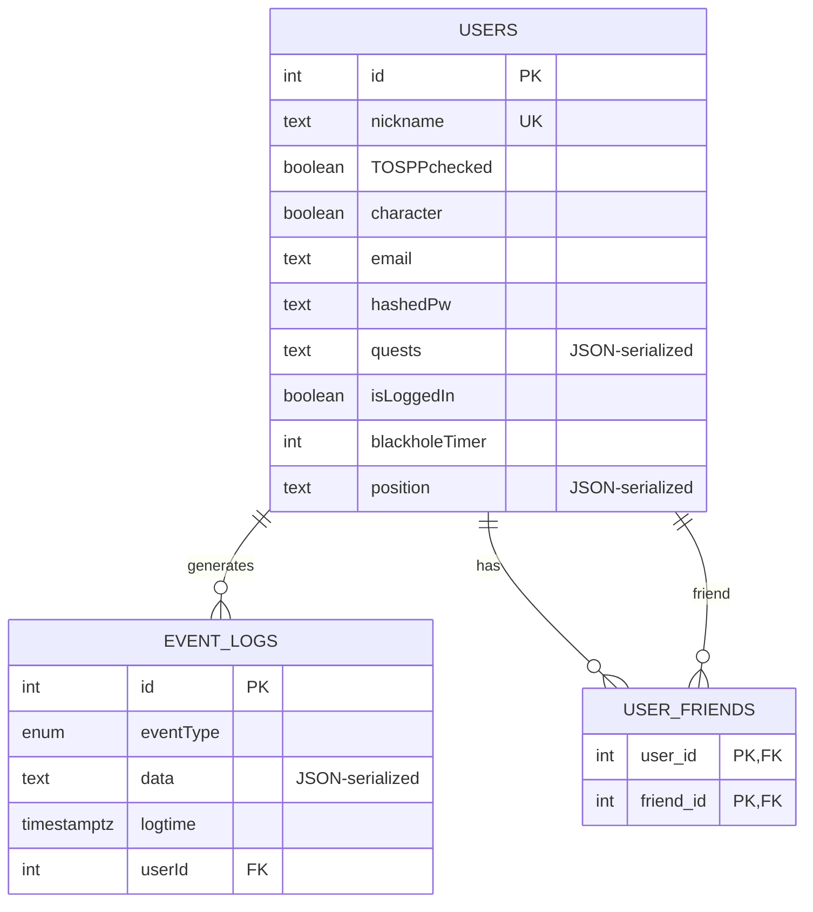

_This project was created as part of the 42 curriculum by
alice, bob, freddy, jeff, and mandy._

# ft_transcendence - A School 3D game

## Description

**ft_transcendence** is a browser-based multiplayer 3D game set in a virtual
42 campus. Players can explore the environment, interact with NPCs and objects,
complete quests, communicate with other players, and challenge them to
mini-games.

The project combines a React and Three.js frontend with four TypeScript/Express
backend services. Real-time communication is provided by Socket.IO, while
authentication, user state, friendships, event logs, and game results are
handled by backend services backed by PostgreSQL.

Microservices are a central architectural part of this project. Instead of
using one monolithic backend, the application separates backend responsibilities
into focused services:

- **`auth-service`** handles login, logout, JWT session cookies, and session
  validation.
- **`user-service`** handles user data, profiles, character selection,
  friendships, quests, terms-of-service state, and persistent player state.
- **`eventlog-service`** stores authenticated events, including `GameResult`
  records used by the frontend match-history view and leaderboard.
- **`conn-service`** manages Socket.IO connections, player presence, movement,
  chat, spectator mode, and real-time mini-game messages.
- **PostgreSQL** stores persistent data used by the backend services.
- **Nginx** provides the public HTTPS entry point and routes API and WebSocket
  traffic to the correct internal service.

This separation gives each service a clear responsibility and makes the
backend easier to develop, test, maintain, and extend.

Key features include:

- a React/Vite frontend and Express-based TypeScript backend;
- a navigable Three.js 3D campus with animated characters, NPCs, quests, and
  interactive objects;
- real-time multiplayer movement, presence, chat, mini-games, and spectator
  mode for players on separate computers;
- Rock-Paper-Scissors and Tic-Tac-Toe, with support for multiple connected
  players and graceful disconnect handling;
- profiles, friends, online status, authentication, event logs, and persistent
  game results stored through TypeORM and PostgreSQL.

## Instructions

### Prerequisites

Choose either the Docker workflow or the local development workflow.

For Docker:

- Docker Engine or Docker Desktop with Docker Compose;
- a recent Docker Compose version that supports the `include` directive used
  by the Compose files;
- at least 4 GB of available memory for the images and services;
- a modern browser with WebGL support.

The Docker workflow builds the frontend, four backend services, PostgreSQL,
pgAdmin, and the Nginx reverse proxy. Make sure the following host ports are
available before starting:

|   Port | Service                       |
| -----: | ----------------------------- |
| `1111` | HTTPS application entry point |
| `8080` | pgAdmin                       |
| `5432` | PostgreSQL                    |

On Windows, Docker Desktop is recommended. The certificate-generation script
is a Bash script and requires Git Bash, WSL, or another Bash environment with
OpenSSL installed. Docker commands themselves can be run from PowerShell.

For local development:

- Node.js 22 or newer;
- npm;
- GNU Make for the optional Makefile shortcuts;
- Docker Compose for the PostgreSQL development container;
- a modern browser with WebGL support.

### Configuration

The repository uses `.env` for Docker service configuration and `dev.env` for
local development. They contain service addresses and ports, PostgreSQL
connection values, and the JWT signing secrets:

```env
AUTH_SERVICE_PORT=3001
EVENTLOG_SERVICE_PORT=3002
USER_SERVICE_PORT=3003
CONN_SERVICE_PORT=3000
INTERNAL_JWT_SECRET=your_internal_jwt_secret_key
JWT_SECRET=your_jwt_secret_key
DB_HOST=postgres
DB_PORT=5432
DB_USER=postgres
DB_PASSWD=postgres
DB_NAME=postgres
```

For local development, use `DB_HOST=localhost`, `AUTH_SERVICE_ADDR=http://localhost`,
and `USER_SERVICE_ADDR=http://localhost`. Docker uses the service hostnames
`postgres`, `auth-service`, and `user-service`. These values are intended for
development; replace all secrets and database credentials before using the
project in any non-development environment.

### Docker execution

1. Clone the repository and open a terminal at its root.
2. Check that Docker is available:

    ```bash
    docker --version
    docker compose version
    ```

3. Build and start the complete stack:

    ```bash
    docker compose up --build
    ```

4. Open `https://localhost:1111` in a browser. The local certificate is
   self-signed, so the browser may display a certificate warning.
5. Stop the stack when finished:

    ```bash
    docker compose down
    ```

To run the stack in the background, use:

```bash
docker compose up --build -d
```

Check the service status after startup:

```bash
docker compose ps
```

All application containers should be running. PostgreSQL should report a
healthy status before the database-dependent services are used. To follow all
service output, run:

```bash
docker compose logs -f
```

The main application is available at `https://localhost:1111`. The development
pgAdmin instance is available at `http://localhost:8080`. PostgreSQL is exposed on
`localhost:5432` for local administration tools; application code inside the
Docker network connects to the hostname `postgres`.

To remove containers and networks while keeping the PostgreSQL data volume:

```bash
docker compose down
```

To deliberately remove the local PostgreSQL data and recreate the database:

```bash
docker compose down -v
docker compose up --build
```

The `-v` option is destructive for local database data. Do not use it when
existing development data should be preserved.

#### Docker troubleshooting

If a service does not start, inspect its logs:

```bash
docker compose logs auth-service
docker compose logs user-service
docker compose logs eventlog-service
docker compose logs conn-service
docker compose logs postgres
docker compose logs nginx
```

Common causes are unavailable host ports, Docker not having enough resources,
or PostgreSQL still starting. If PostgreSQL is still initializing, wait for
its health check and inspect the database logs before restarting the
application services. TLS certificates are generated by the `cert-generator`
Compose service and stored in the `tls-certs` Docker volume. If Compose rejects
`include`, update Docker Compose to a recent version.

### Local development execution

1. Install the workspace dependencies from the repository root:

```bash
npm install
```

2. Start the PostgreSQL development container and backend microservices:

    ```bash
    make backend-dev
    ```

    Alternatively, run the backend commands described in the development
    instructions above.

3. In a second terminal, start the frontend:

    ```bash
    make frontend-dev
    ```

    Alternatively, run `npm run dev:frontend` from the repository root.

4. Open the local URL printed by Vite.

On Windows, use the dedicated Makefile target to start the database and each
backend service in separate PowerShell windows:

```powershell
make backend-dev-win
```

Then start the frontend from the repository root:

```powershell
npm run dev:frontend
```

To build the complete workspace without starting services:

```bash
npm run build
```

This builds `ftr-common`, backend utilities, the backend services, and the
frontend. Backend integration tests are available from the test workspace:

```bash
npm run all --workspace=backend/tests
```

### Service routing

In the complete Docker setup, Nginx exposes one public HTTPS endpoint while
the individual services communicate inside the Docker network:

| Route                                                           | Destination        | Purpose                                                                        |
| --------------------------------------------------------------- | ------------------ | ------------------------------------------------------------------------------ |
| `/`                                                             | `frontend`         | React/Vite application                                                         |
| `/api/login`, `/api/logout`, `/api/validateSession`             | `auth-service`     | Authentication and session APIs                                                |
| `/api/eventlog`, `/api/eventlog/all`, `/api/eventlog/matchhist` | `eventlog-service` | Event logging, leaderboard, and match-history APIs                             |
| `/api/user`, `/api/user/*`                                      | `user-service`     | User data, profiles, friendships, quests, TOSPP, registration, and health APIs |
| `/socket.io`                                                    | `conn-service`     | Real-time multiplayer communication                                            |

The service containers are started with Docker Compose. In local development,
the same services can be run independently while PostgreSQL is provided by the
database Compose configuration.

## Game Instructions

### Starting the game

1. Start the complete stack with Docker or start the backend and frontend
   locally.
2. Open the game in a modern browser with WebGL support.
3. Log in or register, choose a character, accept the Terms of Service and
   Privacy Policy, and enter the campus.
4. Click inside the game canvas before using the keyboard. This ensures that
   the browser window has focus.

### Movement and interaction controls

| Action                                              | Control              |
| --------------------------------------------------- | -------------------- |
| Move forward                                        | `W` or `Arrow Up`    |
| Move backward                                       | `S` or `Arrow Down`  |
| Move left                                           | `A` or `Arrow Left`  |
| Move right                                          | `D` or `Arrow Right` |
| Interact with an object, NPC, door, token, or quest | `E`                  |
| Challenge a nearby player to Rock-Paper-Scissors    | `B`                  |
| Send a friend request to a nearby player            | `F`                  |
| Accept a friend or game request                     | `Z` or `Y`           |
| Decline a friend or game request                    | `X`                  |
| Leave an open Tic-Tac-Toe game                      | `Escape`             |
| Skip a cutscene                                     | `Escape`             |

### Finding and using the key/token

The first campus quest is **Find lost dropped Token**. In the game it is
displayed as a floating `🔑` marker near the campus entrance area:

1. Follow the starting area toward the entrance/front desk.
2. Walk into the interaction area around the floating key marker.
3. When **Press: [E]** appears, press `E`.
4. The marker disappears and the token quest is collected.
5. Return to the front-desk NPC and press `E` while nearby.
6. Use the token at the front entrance to complete **Enter 42 campus via
   token** and continue exploring.

If the `Press: [E]` prompt is not visible, move closer to the marker, make sure
the quest interaction is enabled, and click the game canvas to restore focus.

### Campus quests and objects

Explore the campus and approach objects or NPCs that display an interaction
prompt. Press `E` to interact with:

- the lost token and front entrance;
- NPCs and their dialog;
- the rubber duck, coffee, paper, and computer-login preparation quests;
- evaluation-related NPCs and terminals;
- event-space doors after the required evaluation quests are complete.

Quest progress is saved to the user record and synchronized when reconnecting.
The event log records quest completion and relevant NPC or world events.

### Multiplayer and social features

Other connected players appear in the shared 3D campus. You can move around
together, see presence and movement updates, use in-world chat, open profiles,
send or manage friend requests, and challenge nearby players. The server
handles connection and disconnection events so the world can contain more than
two players at the same time.

To interact with a nearby player, move close enough for the relevant action:

- press `B` to send a Rock-Paper-Scissors challenge;
- press `F` to send a friend request;
- press `Z` or `Y` to accept a pending request;
- press `X` to decline a pending request.

### Mini-games

#### Rock-Paper-Scissors

1. Stand near another player and press `B`.
2. The other player accepts with `Z` or `Y`.
3. Choose a move using:
    - `1` or Numpad `1` for Rock;
    - `2` or Numpad `2` for Paper;
    - `3` or Numpad `3` for Scissors.
4. The result, draw, timeout, and opponent are shown in the game UI and
   recorded as a `GameResult` event.

#### Tic-Tac-Toe

1. Find the in-world Tic-Tac-Toe board.
2. Click the board to join or start the game when the start control is
   available.
3. During your turn, click an available board cell to place your mark.
4. The game handles turns, wins, draws, remote players, and disconnections.
5. If you are waiting alone in the board, press `Escape` to leave.

### Spectator mode and persistence

Users can enter the campus as spectators and observe the shared world without
joining a mini-game as an active player. Real-time movement, chat, game
messages, friend requests, quest updates, and presence are synchronized
through Socket.IO.

User state, friendships, quests, player position, login state, and event logs
are persisted through the backend services and PostgreSQL. Match history and
leaderboard data are derived from stored `GameResult` events; there is no
separate match-history table.

## Team Information

Product Owner, Tech Lead, Project Manager

| Team member                     | Role(s)   | Responsibilities                                                                                   |
| ------------------------------- | --------- | -------------------------------------------------------------------------------------------------- |
| Anatolij Semykin (`alice`)   | Developer | Product direction, 3D environment, character assets, visual interactions, and frontend integration |
| Daniel Helmert (`bob`)     | Developer | Architecture, real-time multiplayer, mini-games, frontend refactoring                              |
| Moritz Maurer (`freddy`)       | Developer | Architecture, Planning, coordination, build reliability, and integration                           |
| George Lukas Wagner (`jeff`) | Developer | Feature development, testing, and integration support                                              |
| Maryam Pazouki (`mandy`)     | Developer | User-facing flows, Database, Documentation                                                         |

The team shared responsibility for code review, debugging, testing, and
integration. Role descriptions identify the main areas of responsibility and
do not exclude contributions to other parts of the project.

## Project Management

Work was divided into frontend gameplay and UI, real-time multiplayer,
backend services, persistence, deployment, and integration. The team used one
`development` branch for ongoing project work and feature integration. The
`main` branch was reserved for production-ready and final project code.
Changes were reviewed through pull requests before being merged into the
appropriate branch. The shared `ftr-common` workspace and
the repository Makefile were used to keep frontend/backend contracts and
development commands consistent.

GitHub Issues and pull requests were used to track work and discuss bugs and
features. The team also used a **GitHub Project board** to organize issues,
prioritize tasks, and monitor their progress. GitHub was also used for code
review and integration. The team used regular meetings and a shared team chat
in Slack for day-to-day communication.

## Technical Stack

- **Frontend:** React, TypeScript, Vite, Three.js, Socket.IO Client, Ant
  Design, and Axios. The production frontend image builds static assets and
  writes them to a shared volume served by Nginx.
- **Backend:** Node.js 24, TypeScript, Express, Socket.IO, TypeORM, JWT,
  bcrypt, `express-validator`, and `tslog`.
- **Database:** PostgreSQL with TypeORM synchronization enabled for
  development; the current schema stores users, event logs, and friendships.
- **Infrastructure:** Docker Compose, Nginx TLS termination, Docker BuildKit,
  and pgAdmin.
- **Shared code:** The `ftr-common` workspace exports API paths, shared
  TypeScript types, authentication middleware, internal service authentication,
  utility functions, and TypeORM entities for the frontend and backend.

### Major Technical Decisions

- **Three.js** was chosen to build the interactive 3D campus with animated
  models, cameras, collisions, and world interactions.
- **Socket.IO** provides low-latency bidirectional communication for movement,
  chat, multiplayer synchronization, and mini-games.
- **Microservice-style backend services** separate authentication, user data,
  event logging, and real-time communication into independently built and
  containerized services. Internal service calls use a separate JWT secret
  from user-facing session authentication.
- **Nginx as a reverse proxy** gives the browser one HTTPS entry point while
  routing REST and WebSocket requests to the appropriate internal service.

### Backend microservice architecture

The backend contains **4 microservices**, organized around independent
responsibilities rather than one monolithic API:

```text
Browser
  |
  v
Nginx reverse proxy
  |-- auth-service ------\
  |-- user-service -------+--> PostgreSQL
  |-- eventlog-service ---/
  `-- conn-service <---- Socket.IO
```

The services are independently built and containerized, while the `ftr-common`
workspace provides shared TypeScript contracts, API constants, middleware,
internal authentication helpers, and ORM entities. Each Dockerfile uses a
multi-stage Node 24 build and installs production dependencies in its runtime
image.

The four backend microservices are:

1. `auth-service`
2. `user-service`
3. `eventlog-service`
4. `conn-service`

The `frontend`, `nginx`, `postgres`, and `pgadmin` containers are supporting
application or infrastructure containers. They are not counted as backend
microservices.

## Database Schema

The project uses one PostgreSQL database shared by the backend services. The
database schema is defined by TypeORM entities and currently contains
**2 entity tables and 1 relation table**. The entities are defined in
`ftr-common/src/ormTypes.ts` (`ORMUser` and `ORMEventLog`). The
authentication, user, and event-log services register these shared entities.
The `conn-service` keeps live multiplayer state in memory and does not define
or persist any TypeORM entities.

### `users`

Owned by the shared backend data model and accessed by `auth-service`,
`user-service`, and `eventlog-service`.

- `id`: generated primary key
- `nickname`: unique text login name, defaulting to an empty string
- `TOSPPchecked`: boolean indicating acceptance of the terms and privacy policy,
  defaulting to `false`
- `character`: boolean representing the selected character, defaulting to
  `true`
- `email`: text email address, defaulting to an empty string
- `hashedPw`: bcrypt password hash, defaulting to an empty string; plaintext
  passwords are never stored
- `quests`: JSON-serialized quest progress, initialized from
  `InitialQuestStatus`
- `isLoggedIn`: boolean login-presence flag, defaulting to `false`
- `blackholeTimer`: integer timer in seconds, defaulting to the configured
  black-hole duration
- `position`: JSON-serialized player position, initialized from
  `PLAYER_START_POSITION`
- `eventLogs`: one-to-many TypeORM relation to the user's event records
- `friends`: many-to-many TypeORM relation to other users through
  `user_friends`

When the authentication service starts, it also attempts to create the
configured default development users if they do not already exist.

### `event_logs`

Owned and written by `eventlog-service`; the other services emit events through
its API.

- `id`: generated primary key
- `eventType`: enum containing `PlayerJoined`, `PlayerLeft`,
  `PlayerInRange`, `FriendRequest`, `GameResult`, `ChatMsg`,
  `QuestCompleted`, `Blackholed`, `NickChange`, `CharChange`, or `None`
- `data`: nullable JSON-serialized event payload
- `logtime`: timestamp with microsecond precision
- `user`: many-to-one TypeORM relation to `users`

The current match-history endpoint reads the most recent `GameResult` records
from `event_logs`; there is no separate match-history table. Event payloads
contain the game, outcome, and opponent nickname for game results, and
corresponding data for chat, quests, presence, and friend requests. The
leaderboard endpoint aggregates stored event data rather than reading a
separate leaderboard table.

### `user_friends`

TypeORM creates this relation table from the self-referencing many-to-many
`ORMUser.friends` relation. It is configured with the following columns:

- `user_id`: foreign key to `users.id`
- `friend_id`: foreign key to `users.id`

The application is responsible for treating friendship pairs consistently and
avoiding duplicate or reversed pairs where appropriate.

The following entity-relationship diagram shows the current TypeORM-backed
schema. The `users` to `event_logs` relation is created from
`ORMEventLog.user`. The two relationships to `user_friends` are the join-table
links created by `ORMUser.friends`.



`user_friends` is a TypeORM-generated join table rather than a separately
declared entity. TypeORM also creates the foreign-key column used by
`event_logs.user`. The schema is synchronized independently by each service
that registers the shared entities, so all services must use the same database
configuration.

In practice, `auth-service` creates and validates records in `users`.
`user-service` manages user data, friend relationships, quests, TOSPP state,
presence, and player state. `eventlog-service` stores events and serves
leaderboard and match history from those events. The `conn-service` handles
live multiplayer state and does not write directly to PostgreSQL; persistent
events and results are sent through the appropriate backend APIs.

The browser never accesses PostgreSQL directly. Database access, validation,
authentication, and persistence logic stay inside the appropriate backend
service, preserving the service boundaries and protecting database
credentials.

### Database setup and lifecycle

The PostgreSQL instance is started by `backend/compose-db.yaml` and is included
in the complete Docker Compose stack. Its data is stored in the named Docker
volume `ftr-db`, so restarting the containers does not delete application
data. To deliberately reset the local database, stop the stack and run:

```bash
docker compose down -v
docker compose up --build
```

The services currently use TypeORM with `synchronize: true`. This is
convenient for local development because tables are created or updated from
the entity definitions automatically, but it is not a migration strategy for
production. A production deployment should use versioned TypeORM migrations
and non-development credentials. Because multiple services register the shared
entities, they must point to the same PostgreSQL schema.

The PostgreSQL Compose setup also includes a `pgadmin` administration
container. It is a development tool, not an application database table. With
the default local configuration, pgAdmin is available at `http://localhost:8080`
and connects to the PostgreSQL service using the `postgres` database and user.

## Features List

| Feature                              | Description                                                                                                                          | Contributors                                                       |
| ------------------------------------ | ------------------------------------------------------------------------------------------------------------------------------------ | ------------------------------------------------------------------ |
| Frontend application                 | React, TypeScript, Vite, Ant Design, reusable UI/context components, and a browser-based game interface                              | Anatolij Semykin, Daniel Helmert, Moritz Maurer                    |
| Backend services                     | Express and TypeScript services expose authentication, user, event-log, and real-time connection APIs                                | Moritz Maurer, Daniel Helmert, George Lukas Wagner, Maryam Pazouki |
| 3D campus and interactions           | Three.js world, GLTF assets, camera, animation, collision, NPCs, quests, doors, tokens, computers, and other interactive objects     | Anatolij Semykin                                                   |
| Real-time multiplayer                | Socket.IO synchronizes connected players, movement, presence, chat, game state, and disconnect handling                              | Anatolij Semykin, Daniel Helmert, Moritz Maurer                    |
| Remote and multi-player sessions     | Players on separate computers can share the same world, while more than two users can be present simultaneously                      | Anatolij Semykin, Daniel Helmert, Moritz Maurer                    |
| Spectator mode                       | Users can observe ongoing multiplayer activity without joining as an active player                                                   | Anatolij Semykin, Daniel Helmert, Moritz Maurer                    |
| In-world chat and social interaction | Chat messages, player chat bubbles, profiles, online status, friend requests, and friend lists                                       | Daniel Helmert, Moritz Maurer, Anatolij Semykin                    |
| Rock-Paper-Scissors                  | Challenge requests, choices, results, draws, timeouts, and persistent game-result events                                             | Daniel Helmert, Anatolij Semykin                                   |
| Tic-Tac-Toe                          | In-world board, turns, wins, draws, and disconnect handling                                                                          | Anatolij Semykin, Daniel Helmert                                   |
| Match statistics and history         | Event-log persistence for game results, leaderboard data, and the frontend match-history view                                        | Daniel Helmert, Moritz Maurer, Maryam Pazouki                      |
| ORM-backed persistence               | TypeORM entities and repositories store users, friendships, player state, and event logs in PostgreSQL behind the backend services   | Moritz Maurer, Daniel Helmert, Maryam Pazouki                      |
| Microservice architecture            | Separate authentication, user, event-log, and real-time connection services with clear API boundaries and Docker Compose integration | Moritz Maurer, George Lukas Wagner, Maryam Pazouki                 |

## Modules

The point values below follow the 42 convention: a major module is worth
2 points and a minor module is worth 1 point. The modules listed below
correspond to the modules selected and implemented by the team for the
project evaluation.

| Module                                   | Type  | Points | How it was implemented                                                                                                               | Why it was chosen                                                                               | Contributors                                                       |
| ---------------------------------------- | ----- | -----: | ------------------------------------------------------------------------------------------------------------------------------------ | ----------------------------------------------------------------------------------------------- | ------------------------------------------------------------------ |
| Use a frontend framework                 | Minor |      1 | React, TypeScript, Vite, Ant Design, and reusable UI/context components                                                              | Provides the structured browser application and interface for the game                          | Anatolij Semykin, Daniel Helmert, Moritz Maurer                    |
| Use a backend framework                  | Minor |      1 | Node.js, TypeScript, and Express services expose the authentication, user, event-log, and connection APIs                            | Provides consistent routing, middleware, validation, and service boundaries                     | Moritz Maurer, Daniel Helmert, George Lukas Wagner, Maryam Pazouki |
| Implement real-time features             | Major |      2 | Socket.IO synchronizes movement, presence, chat, spectator state, and mini-game messages, including disconnect handling              | Makes the campus a shared real-time experience                                                  | Anatolij Semykin, Daniel Helmert, Moritz Maurer                    |
| Allow users to interact with other users | Major |      2 | Profiles, friends, online status, in-world chat, and multiplayer interactions                                                        | Supports social interaction beyond individual matches                                           | Daniel Helmert, Moritz Maurer, Anatolij Semykin                    |
| Use an ORM                               | Minor |      1 | TypeORM entities and repositories persist users, friendships, player state, and events in PostgreSQL                                 | Keeps database access typed and aligned with the service domain models                          | Moritz Maurer, Daniel Helmert, Maryam Pazouki                      |
| Game statistics and match history        | Minor |      1 | Game results are stored as `GameResult` events and exposed through leaderboard and match-history APIs                                | Lets users review outcomes and track progress over time                                         | Daniel Helmert, Moritz Maurer, Maryam Pazouki                      |
| Web-based game                           | Major |      2 | Browser-based Rock-Paper-Scissors and Tic-Tac-Toe with live rules, turns, results, draws, and disconnect handling                    | Delivers the core playable experience directly in the browser                                   | Anatolij Semykin, Daniel Helmert, Moritz Maurer                    |
| Remote players                           | Major |      2 | Socket.IO transports game state between clients and handles connection and disconnection events                                      | Allows players on separate computers to play together                                           | Anatolij Semykin, Daniel Helmert, Moritz Maurer                    |
| Multiplayer (>2 players)                 | Major |      2 | The shared 3D world supports multiple connected players, synchronized presence, movement, chat, and spectators                       | Makes the game world collaborative rather than limited to a single pair of players              | Anatolij Semykin, Daniel Helmert, Moritz Maurer                    |
| Add another game                         | Major |      2 | Tic-Tac-Toe and Rock-Paper-Scissors are distinct in-world games with results and history support                                     | Adds variety while reusing the common multiplayer and persistence infrastructure                | Anatolij Semykin, Daniel Helmert, Moritz Maurer                    |
| Advanced 3D graphics                     | Major |      2 | Three.js renders the campus, GLTF assets, animated characters, collisions, NPCs, quests, and interactions                            | Creates an immersive environment for the multiplayer games                                      | Anatolij Semykin                                                   |
| Spectator mode                           | Minor |      1 | Connected users can observe ongoing multiplayer activity through the connection service and synchronized world state                 | Allows users to follow games without joining as an active player                                | Anatolij Semykin, Daniel Helmert, Moritz Maurer                    |
| Backend as microservices                 | Major |      2 | Separate TypeScript services handle authentication, users, event logging, and real-time connections, coordinated with Docker Compose | Separates responsibilities and enables clear API boundaries and independent service development | Moritz Maurer, George Lukas Wagner, Maryam Pazouki                 |

**Total: 21 points** — eight major modules at 2 points each (16 points) and
five minor modules at 1 point each (5 points).

### Challenges and solutions

- **Real-time state:** Shared TypeScript payload types and Socket.IO events
  keep player, chat, and mini-game state consistent between services.
- **3D interaction:** Three.js collision and scene helpers were used to keep
  movement and object interactions manageable as the campus grew.
- **Service coordination:** Docker Compose, Nginx, and the shared environment
  configuration provide a repeatable way to run the frontend, independent
  backend microservices, database, and reverse proxy together.
- **Service boundaries:** Splitting authentication, user data, event logging,
  and real-time communication into separate services reduced coupling and
  allowed the team to work on backend areas independently.
- **Persistent progress:** TypeORM entities persist user, friendship, quest,
  presence, and player-state data, while event APIs persist chat, quest,
  presence, friend-request, and game-result events across reconnects.

<!--
## Known limitations

- The local HTTPS certificate is intended for development and may trigger a
  browser warning.
- Some account and persistence flows are still being refined.
- The default database credentials in `dev.env` and Docker Compose are for
  local development only.
- The 3D experience requires a browser with WebGL support.
-->

## Individual Contributions

### Anatolij Semykin

- Developed and integrated 3D environment elements, models, animations, and
  character variations.
- Implemented and maintained Rock-Paper-Scissors and Tic-Tac-Toe logic.
- Worked on NPCs, visual interactions, map previews, and scene presentation.
- Helped coordinate product direction and frontend integration.

### Daniel Helmert

- Developed and refactored multiplayer synchronization and Socket.IO events.
- Worked on friends, profiles, leaderboards, event history, quests, and shared
  frontend/backend types.
- Improved frontend structure, movement, rendering, and game UI.

### Moritz Maurer

- Worked on project coordination, integration, build reliability, and Docker
  workflows.
- Helped define and review the microservice architecture and the boundaries
  between authentication, user data, event logging, and real-time
  communication.
- Contributed extensively to backend service integration, authentication
  infrastructure, database access, Docker workflows, and development tooling.

### George Lukas Wagner

- Contributed to feature development, testing, and integration work.
- Supported the team with debugging and validation of the application stack.

### Maryam Pazouki

- Worked on user-facing login flows, developed and maintained the `user-service` for user profiles.
- Documented the database schema, README.

## Resources

The following resources were used during development and documentation:

- https://developer.mozilla.org/en-US/docs/Web/JavaScript/Guide/Language_overview
- [Three.js Manual](https://threejs.org/manual/#en/installation)
- [Three.js Documentation](https://threejs.org/docs/)
- https://www.xjavascript.com/blog/socket-io-typescript-express/
- [React Context Documentation](https://react.dev/learn/passing-data-deeply-with-context)
- https://codezup.com/building-microservices-with-node-and-express/

Additional project resources:

- [React Documentation](https://react.dev/learn)
- https://www.typescriptlang.org/docs/
- [Socket.IO Documentation](https://socket.io/docs/v4/)
- [TypeORM Documentation](https://typeorm.io/)
- [PostgreSQL Documentation](https://www.postgresql.org/docs/)
- [Docker Compose Documentation](https://docs.docker.com/compose/)
- [Nginx Documentation](https://nginx.org/en/docs/)

### AI usage

AI tools were used as development assistance for researching framework
documentation, discussing implementation approaches, debugging ideas,
proofreading, and structuring this README. All suggestions were reviewed and
adapted by the team. The team remains responsible for the source code,
architecture, testing, and final documentation.

## Credits

This project was created for educational purposes as part of the 42
curriculum.
